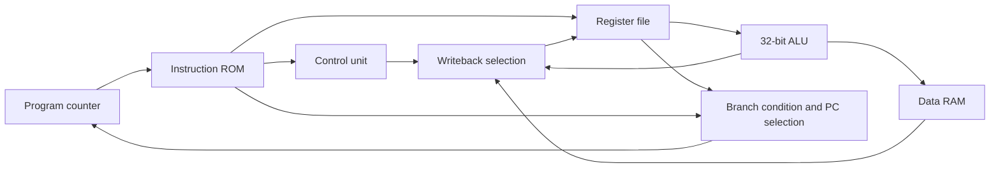

# Single-Cycle Processor in Logisim

A modular **32-bit RISC processor with 24-bit instructions**, designed for **ENCS2380 — Computer Organization and Microprocessors, Spring 2025** using **Logisim 2.7.1**.

**Team:** Hiba Hmidan, Rama Anabtawi, and Nancy Samhan.

The design combines a register file, ALU, instruction and data memories, instruction decoder, main control unit, and PC control logic. The repository includes the original circuit, project report, and instruction test notes.

## Open and simulate

1. Install **classic Logisim 2.7.1**, the version recorded in the circuit XML, with a compatible Java runtime. Compatibility with Logisim-evolution has not been verified.
2. Clone or download this repository.
3. Open `Part3_1230338_1230454_1230926-p3.circ` in Logisim.
4. Select **Datapath** in the circuit list. The file’s default `main` circuit is empty; the integrated processor is in `Datapath`.
5. Keep automatic ticking disabled while setting up. Reset the simulation, inspect the instruction ROM, and initialize RAM for the selected test.
6. Use the Poke tool and manual clock ticks to advance the processor. Observe PC, register values, memory, and control signals against the expected state after each instruction.

The instruction ROM already contains a test sequence. [Simulation and test guidance](docs/SIMULATION.md) explains the memory images, initial values, and address convention. No assembler or automated simulator test harness is included.

## Architecture

| Component | Description |
| --- | --- |
| Datapath | Integrated processor and clock, with a 20-bit PC |
| Register file | Sixteen 32-bit architectural registers; R0 is intended to read as zero and ignore writes |
| ALU | Logic, arithmetic, equality/less-than comparison, shifts, and rotate-right |
| Instruction memory | ROM configured with 20 address bits and 24 data bits |
| Data memory | RAM configured with 20 address bits and 32 data bits |
| Main control | ROM-based decoder with 5 address bits and 12 output bits |
| PC control | Branch condition evaluation and next-PC selection |

The circuit contains `ALU`, `RegFile`, `Datapath`, `Cond`, `PC`, and `Control Unit` subcircuits. It uses built-in Logisim libraries and declares no external library dependencies.



This diagram summarizes the major data flow; the circuit and report contain the complete connections and control signals.

## Instruction set

The assignment defines 28 opcodes:

| Decimal opcode | Instructions |
| --- | --- |
| 0–7 | AND, CAND, OR, XOR, ADD, NADD, SEQ, SLT |
| 8–15 | ANDI, CANDI, ORI, XORI, ADDI, NADDI, SEQI, SLTI |
| 16–19 | SLL, SRL, SRA, ROR |
| 20–23 | BEQ, BNE, BLT, BGE |
| 24–25 | LW, SW |
| 26–27 | J, JAL |

Instruction formats, from most significant to least significant bit:

```text
R-type: [opcode:8][x:4][y:4][z:4][unused:4]
I-type: [opcode:8][x:4][y:4][immediate:8]
J-type: [opcode:8][immediate:16]
```

R-type arithmetic writes `Rx` using `Ry` and `Rz`. `NADD Rx,Ry,Rz` computes `Rz - Ry`; `CAND` computes `~Ry & Rz`. I-type ALU instructions use a signed 8-bit immediate, and shifts use a five-bit shift amount. Branches compare their encoded registers, LW writes a register, and SW reads the register encoded in bits 15–12.

See the [assignment PDF](docs/project-instructions.pdf) for exact instruction semantics and the [report](ENCS2380-Report1.pdf) for implementation and control-signal tables.

## Address convention

The assignment describes byte-addressed instructions with sequential `PC + 3`. The report explicitly describes the implemented alternative: a **24-bit-wide instruction ROM with sequential `PC + 1`**, where each ROM address holds one complete instruction. This distinction matters when calculating branches, jumps, and link addresses. Follow the circuit’s convention when reproducing the existing tests; do not assume byte-addressed offsets apply unchanged.

The configured memory widths describe Logisim memory locations, rather than directly establishing compliance with the assignment’s byte-capacity limits. See [simulation notes](docs/SIMULATION.md) for details.

## Repository contents

| Path | Purpose |
| --- | --- |
| `Part3_1230338_1230454_1230926-p3.circ` | Original integrated processor circuit |
| `ENCS2380-Report1.pdf` | Original design report, control tables, test results, and team contributions |
| `cases/test-cases (1).txt` | Original assembly-like tests, encodings, and expected results |
| `cases/instruction-memory.hex` | Loadable copy of the instruction ROM contents extracted from the circuit |
| `cases/control-rom.hex` | Loadable copy of the control ROM contents extracted from the circuit |
| `docs/project-instructions.pdf` | Original assignment requirements |
| `docs/SIMULATION.md` | Setup, test workflow, and validation scope |

## Verification and status

Repository checks confirmed that the circuit is well-formed XML, all referenced subcircuits resolve, and both extracted ROM images match their embedded source values. The project was **not simulated during this documentation revision**; instruction execution and timing have not been independently verified. Original circuit, report, and test notes are preserved unchanged.

No open-source license is currently included. Original documents retain their attribution.
